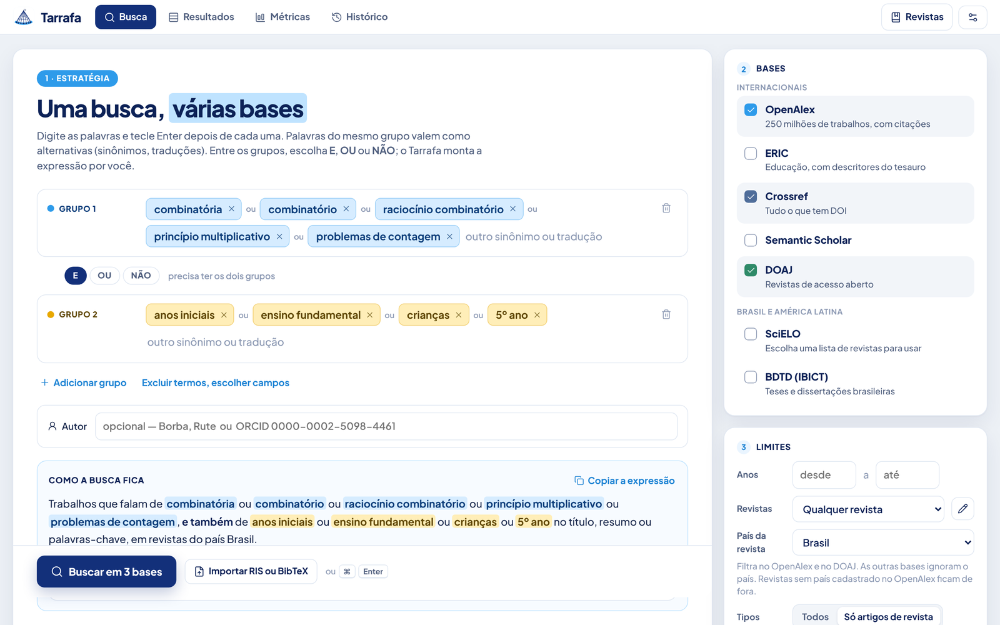
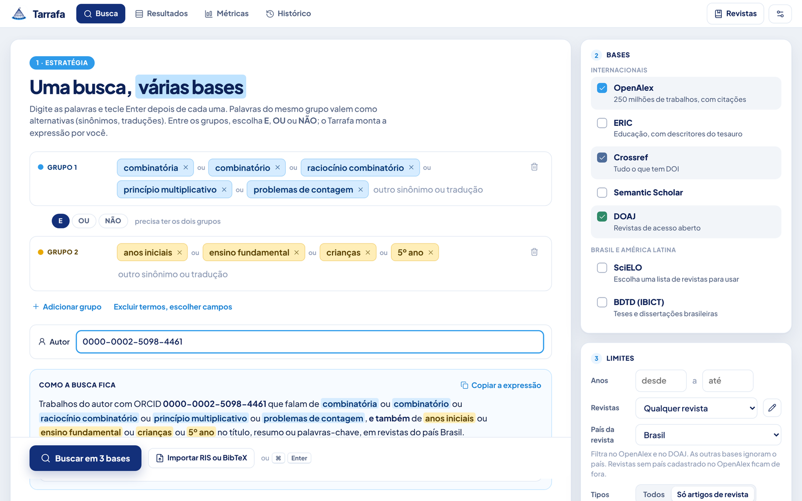
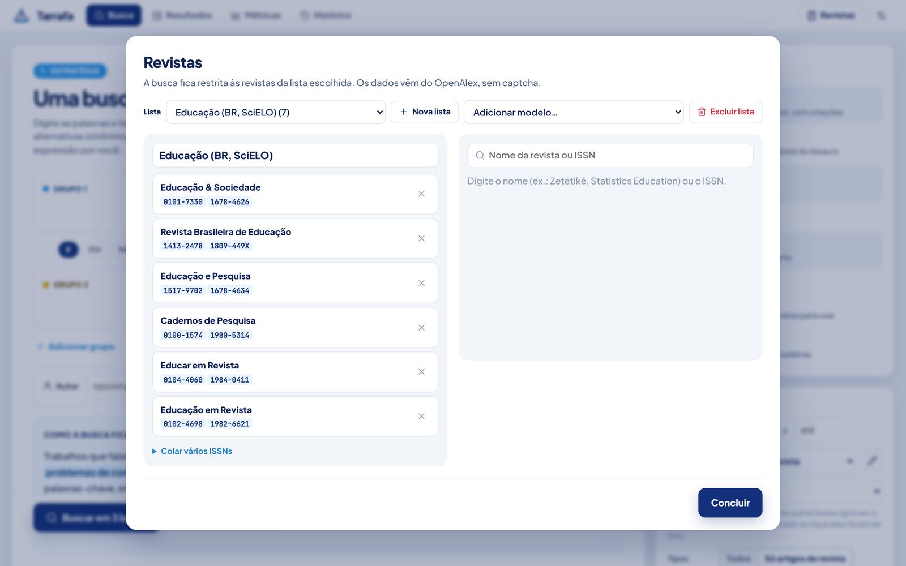
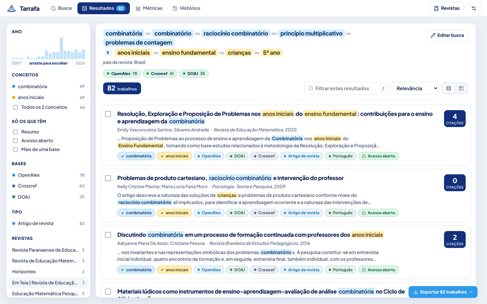
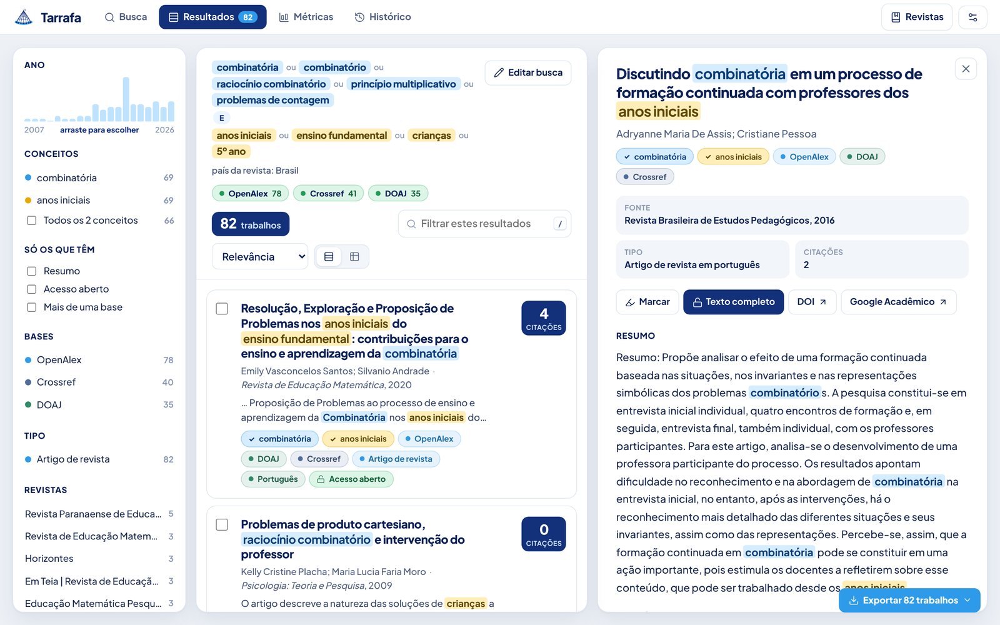
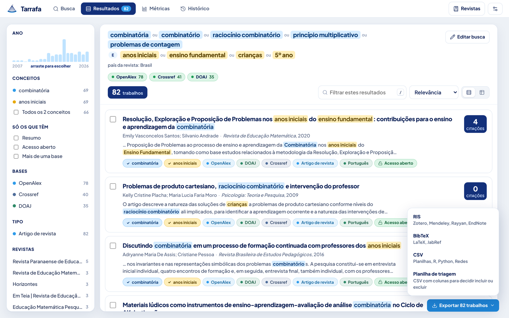
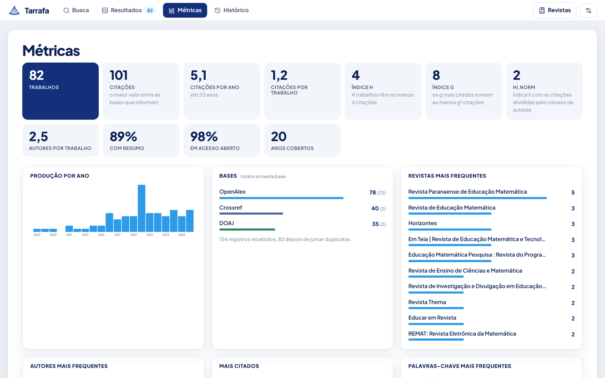
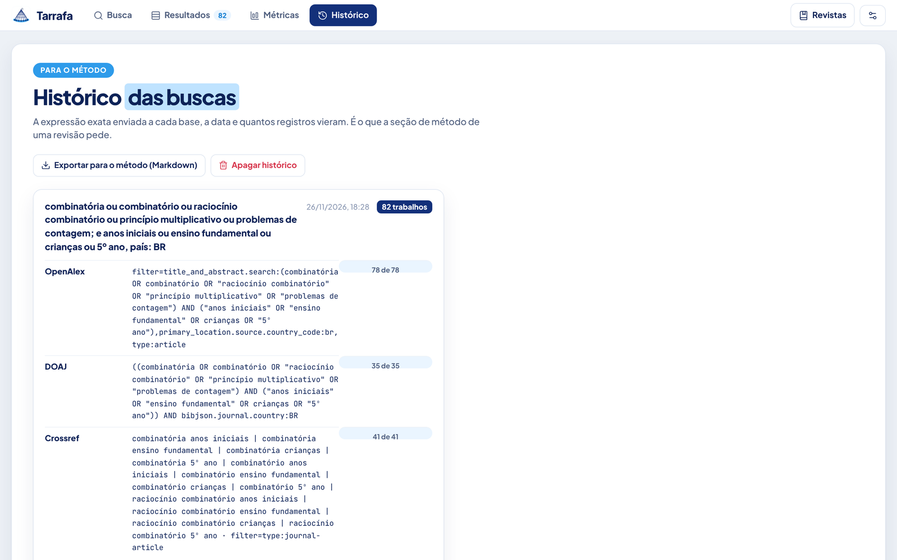
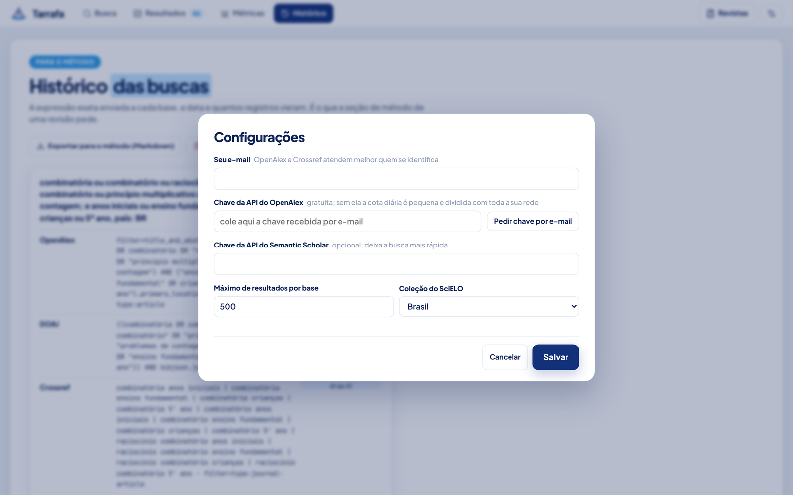

# Tarrafa

Tarrafa é uma ferramenta para **buscar artigos em várias bases de uma vez**, uma versão melhorada do Publish or Perish feita para revisões de literatura. Ela só faz a busca: junta os resultados, tira as duplicatas, mostra métricas e exporta tudo para a triagem em outro programa (Rayyan, Zotero, planilha).

- **Na web:** https://tarrafa.pages.dev
- **No Mac:** aplicativo desktop (Tauri), veja [Instalar no Mac](#instalar-no-mac)

Funciona para qualquer área. Os exemplos abaixo vêm de uma busca real sobre combinatória nos anos iniciais.

---

## Sumário

1. [Montar a busca](#1-montar-a-busca)
2. [Bases](#2-bases)
3. [Autor e ORCID](#3-autor-e-orcid)
4. [Limites: anos, país e tipo](#4-limites-anos-país-e-tipo)
5. [Listas de revistas](#5-listas-de-revistas)
6. [Resultados](#6-resultados)
7. [Leitor](#7-leitor)
8. [Exportar](#8-exportar)
9. [Métricas](#9-métricas)
10. [Histórico (para a seção de método)](#10-histórico-para-a-seção-de-método)
11. [Configurações](#11-configurações)
12. [Como cada base é consultada](#como-cada-base-é-consultada)
13. [Instalar no Mac](#instalar-no-mac)
14. [Desenvolvimento](#desenvolvimento)

---

## 1. Montar a busca



A busca é feita por **grupos de termos**:

- Digite uma palavra e tecle **Enter**. Ela vira uma etiqueta.
- Palavras do **mesmo grupo** são alternativas (sinônimos, traduções, variações): valem como **OU**.
- **Entre os grupos** você escolhe **E**, **OU** ou **NÃO**. Com **E**, o trabalho precisa ter um termo de cada grupo.
- **Adicionar grupo** cria outro conceito (por exemplo, tema + público + método).
- **Excluir termos, escolher campos** permite tirar palavras indesejadas e escolher onde procurar: título, resumo ou palavras-chave.

O quadro **Como a busca fica** descreve a busca em português. **Copiar a expressão** copia a string booleana para colar no protocolo ou em outra base.

Atalhos: **⌘ Enter** (ou Ctrl Enter) busca. **Importar RIS ou BibTeX** abre um arquivo exportado de outra ferramenta e o junta aos resultados.

## 2. Bases

| Base | O que traz | Observações |
|---|---|---|
| **OpenAlex** | Cerca de 250 milhões de trabalhos, com citações | Filtra por país da revista. Busca no título, resumo e palavras-chave |
| **ERIC** | Educação, com descritores do tesauro | Base dos EUA, forte em educação |
| **Crossref** | Tudo o que tem DOI | Não entende E/OU: o Tarrafa faz uma consulta para cada combinação de termos (até 60) e confere o E/OU no próprio Tarrafa |
| **Semantic Scholar** | Indexação ampla, com resumos | A chave é opcional e deixa a busca mais rápida |
| **DOAJ** | Revistas de acesso aberto | Filtra por país da revista |
| **SciELO** | Revistas do SciELO | Busca dentro de uma [lista de revistas](#5-listas-de-revistas) |
| **BDTD (IBICT)** | Teses e dissertações brasileiras | |

Os registros que aparecem em mais de uma base são juntados pelo DOI ou, sem DOI, pelo título e ano. Cada trabalho mostra em quais bases foi encontrado.

## 3. Autor e ORCID



O campo **Autor** aceita um nome (`Borba, Rute`) ou um **ORCID** (`0000-0002-5098-4461`). Com o ORCID, a busca fica exata nas bases que o suportam (OpenAlex, Crossref e DOAJ). Pode ser usado sozinho, para levantar a produção de alguém, ou junto com os termos.

## 4. Limites: anos, país e tipo

- **Anos:** de / até.
- **Revistas:** qualquer revista ou uma lista sua (veja abaixo).
- **País da revista:** vale no OpenAlex e no DOAJ; as outras bases ignoram o país. Revistas sem país cadastrado no OpenAlex ficam de fora.
- **Tipos:** todos ou **só artigos de revista**.

## 5. Listas de revistas



O botão **Revistas** abre o editor de listas. Com uma lista, a busca fica restrita àquelas revistas em todas as bases, e o SciELO passa a funcionar.

- **Adicionar modelo…** traz listas prontas de várias áreas:
  - Educação Matemática (Brasil)
  - Educação Estatística
  - Educação (BR, SciELO)
  - Ensino de Ciências (BR)
  - Saúde Coletiva (BR)
  - Sociologia e Ciência Política (BR)
  - Psicologia (BR)
- **Nova lista:** crie a sua. Digite o nome da revista ou o ISSN; os dados vêm do OpenAlex.
- **Colar vários ISSNs:** cole uma coluna de ISSNs de uma vez.

As listas ficam salvas no navegador (ou no aplicativo).

## 6. Resultados



- No topo ficam a busca feita e quantos registros cada base trouxe (**OpenAlex 78, Crossref 41, DOAJ 35**). Uma etiqueta vermelha indica que a base falhou; passe o mouse para ver o motivo.
- O **filtro lateral** tem:
  - um histograma de anos (arraste para escolher um período);
  - os **conceitos** encontrados em cada trabalho (por exemplo, *Todos os 2 conceitos* mostra só os que têm um termo de cada grupo);
  - **Só os que têm:** resumo, acesso aberto, mais de uma base;
  - bases, tipo e revistas.
- **Filtrar estes resultados** (atalho `/`) filtra o que já veio, sem nova busca.
- Ordene por relevância, citações, ano ou título, em **cartões** ou em **tabela**.
- Os termos da busca aparecem destacados no título e no resumo.
- Marque trabalhos com a caixa para exportar só esses.

## 7. Leitor



Clique num trabalho para abrir o leitor ao lado da lista. Ele mostra o resumo completo, a fonte, o tipo, as citações e os links:

- **Texto completo**, quando há versão aberta;
- **DOI**;
- **Google Acadêmico**.

**Marcar** guarda o trabalho para exportar depois.

## 8. Exportar



| Formato | Para |
|---|---|
| **RIS** | Zotero, Mendeley, Rayyan, EndNote |
| **BibTeX** | LaTeX, JabRef |
| **CSV** | Planilhas, R, Python, [Redes](https://github.com/gerlansilva/redes) |
| **Planilha de triagem** | CSV com as colunas *Decisão* e *Motivo* para decidir incluir ou excluir cada registro |

A exportação respeita os filtros e as marcações: o que estiver na tela é o que sai.

## 9. Métricas



São calculadas sobre os resultados filtrados:

- trabalhos e citações;
- citações por ano e por trabalho;
- índice h, índice g e hI,norm;
- autores por trabalho;
- porcentagem com resumo e porcentagem em acesso aberto.

Também há gráficos de **produção por ano**, **bases** (total e registros só nesta base), **revistas mais frequentes**, **autores mais frequentes**, **mais citados** e **palavras-chave**.

## 10. Histórico (para a seção de método)



Cada busca fica registrada com:

- a **expressão exata enviada a cada base** (incluindo filtros e, no Crossref, a lista de combinações);
- a data e a hora;
- quantos registros cada base devolveu e o total depois de juntar duplicatas.

**Exportar para o método (Markdown)** gera o texto pronto para a seção de método ou o apêndice de uma revisão sistemática, no formato que o PRISMA pede para a busca. O histórico fica no navegador; **Apagar histórico** limpa tudo.

## 11. Configurações



- **Seu e-mail:** o OpenAlex e o Crossref atendem melhor quem se identifica.
- **Chave da API do OpenAlex:** gratuita. Sem ela, a cota diária é pequena e dividida com toda a sua rede. **Pedir chave por e-mail** abre o pedido.
- **Chave do Semantic Scholar:** opcional.
- **Máximo de resultados por base:** padrão de 500.
- **Coleção do SciELO:** Brasil, Portugal, Argentina etc.

Tudo fica guardado só no seu navegador ou no aplicativo.

---

## Como cada base é consultada

- **OpenAlex:** `filter=title_and_abstract.search:(...)`, com país (`primary_location.source.country_code`), tipo, anos e ISSNs da lista.
- **DOAJ:** busca booleana nos campos de título, resumo e palavras-chave, com `bibjson.journal.country`.
- **Crossref:** `query.bibliographic` com uma combinação de termos por consulta (um termo de cada grupo). Vão até 60 consultas; com mais de 12, lê uma página de cada. O E/OU/NÃO é conferido no Tarrafa. O Crossref não tem filtro de país.
- **SciELO:** consulta revista por revista da lista escolhida (ArticleMeta).
- **ERIC, Semantic Scholar, BDTD:** cada uma com a sintaxe própria. A expressão enviada aparece no [Histórico](#10-histórico-para-a-seção-de-método).

Na web, as bases que não aceitam chamadas diretas do navegador passam por um proxy no Cloudflare (`functions/api/proxy.ts`). No aplicativo, as chamadas saem direto do Mac.

## Instalar no Mac

Você precisa do [Node.js](https://nodejs.org) e do [Rust](https://rustup.rs).

```bash
git clone https://github.com/gerlansilva/tarrafa.git
cd tarrafa
./build-mac.sh
```

O script gera o `Tarrafa.app` e o `.dmg` e os **assina ad hoc** (assinatura gratuita, sem conta de desenvolvedor). Na primeira abertura, clique com o botão direito no app e escolha **Abrir**.

## Desenvolvimento

```bash
npm install
npm run dev          # versão web em http://localhost:5173
npm run tauri dev    # aplicativo desktop
npm run build        # gera dist/ (publicado no Cloudflare Pages)
```

Estrutura:

- `src/main.ts`: interface;
- `src/store.ts`: listas de revistas, modelos e configurações;
- `src/sources/*.ts`: um arquivo por base;
- `functions/api/proxy.ts`: proxy do Cloudflare Pages;
- `src-tauri/`: aplicativo desktop;
- `docs/prints/`: as capturas deste README.

Cada push no `main` publica a versão web automaticamente no Cloudflare Pages.
